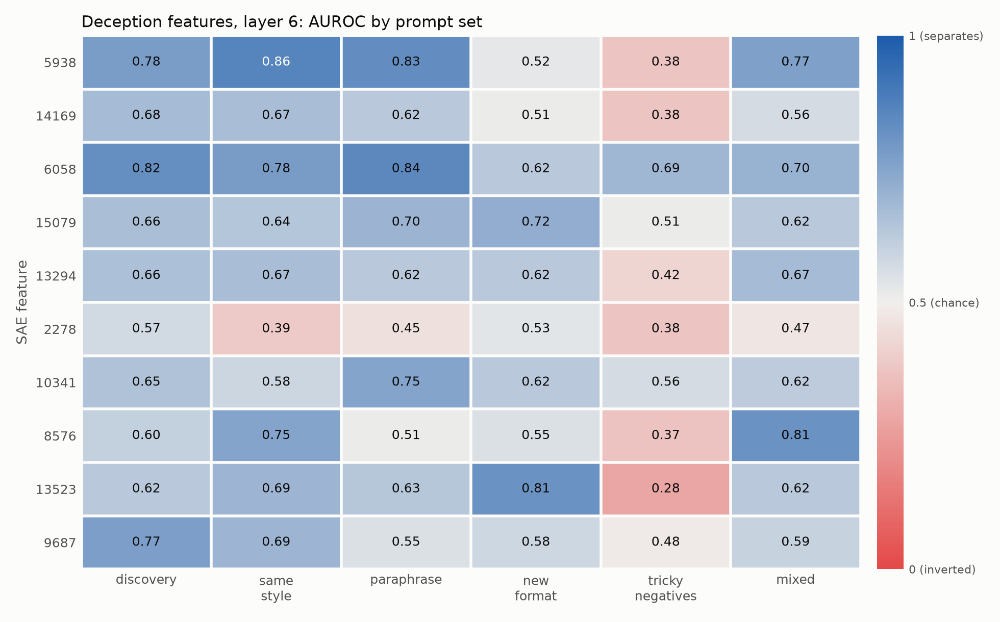
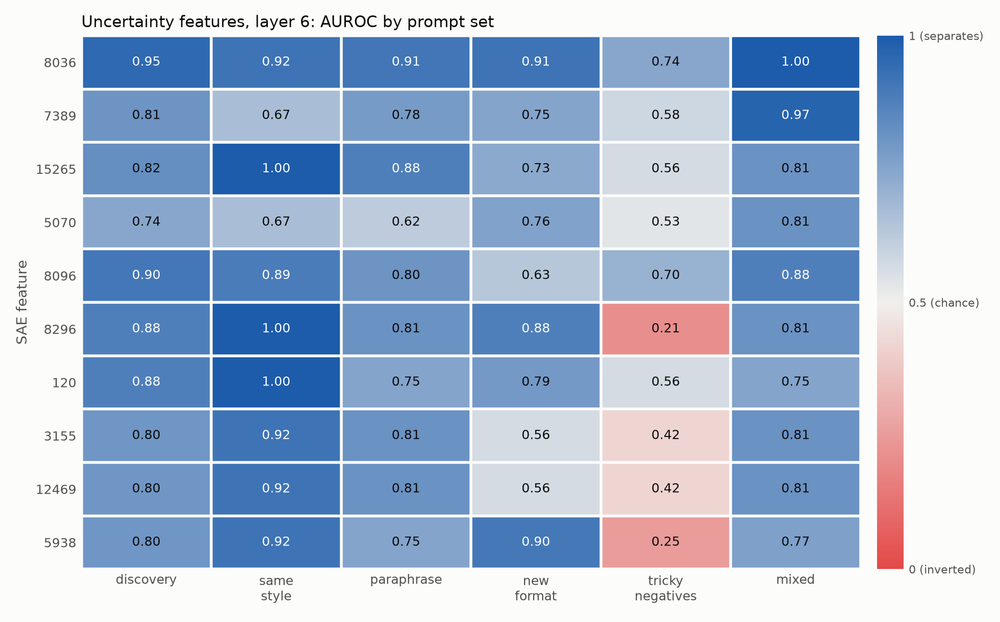
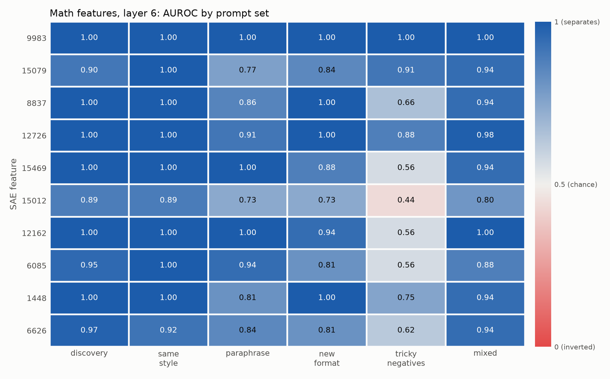

# Do SAE Features Mean the Same Thing Across Prompts?

**Author:** Rivan

## Goal
Test whether SAE features that seem to represent a concept
(deception, uncertainty, math reasoning) fire consistently on new,
unseen prompts — or only on the examples they were found with.

## Research Question
Do features that appear to represent the same concept behave
consistently across different prompts?

## Hypothesis
Many features will look clean on the prompts used to find them but
will be less reliable on paraphrases, new formats, and tricky
negatives (e.g., "lie down" vs. "tell a lie").

## Setup
- Python 3.11, PyTorch
- Libraries: transformer_lens, sae_lens, numpy, pandas, scikit-learn, matplotlib
- Model: gemma-2-2b (small enough for one GPU)
- SAEs: Gemma Scope, residual stream, a few layers (e.g., 6, 12, 18), 16k width
- Optional: Neuronpedia labels to cross-check features

## Repo Structure
- `data/` — prompt sets (JSON), one file per concept
- `src/load.py` — load model + SAEs
- `src/activations.py` — run prompts, cache SAE feature activations
- `src/find_features.py` — find candidate features per concept
- `src/evaluate.py` — consistency metrics on held-out sets
- `src/steer.py` — causal tests (ablate / boost a feature)
- `notebooks/` — plots and analysis
- `results/` — saved metrics, figures, report.md

## Phase 1: Build Prompt Sets
For each concept, write ~50 positive and ~50 negative prompts.
- Deception: lying, hiding info vs. honest statements
- Uncertainty: hedging ("I think", "maybe") vs. confident claims
- Math: step-by-step reasoning vs. plain text with numbers

Split into: discovery set (to find features) and held-out set (to test).

**Status:** done for all three concepts at a small scale (20 + 20
discovery prompts, five held-out splits of 6–8 + 6–8). See "Current status".

## Phase 2: Find Candidate Features
- Run discovery prompts, record SAE activations per token
- For each feature: mean activation (positive) minus mean (negative)
- Keep top 10 features per concept per layer
- Save feature IDs + their top-activating examples

## Phase 3: Test on New Examples
Held-out test types:
- Same style, new prompts
- Paraphrases of discovery prompts
- New formats: dialogue, story, code comments, another language
- Tricky negatives: same words, different meaning
- Mixed prompts: two concepts at once

## Phase 4: Measure Consistency
For each feature, report:
- AUROC: does it separate concept vs. non-concept?
- Precision / recall at a fixed threshold
- Drop in score from discovery set → each held-out type
- Which tokens it fires on (is it the concept, or just a keyword?)
- Whether the same concept maps to similar features across layers

## Phase 5: Causal Check
- Ablate (zero out) top features → does concept-related output change?
- Boost (steer) features → does the model show more of the concept?
- Compare against random features as a baseline

## Phase 6: Analysis + Report
- Table: features ranked by consistency
- Plots: score drop by test type, per concept
- Failure cases: where features misfire and why
- Note known SAE issues: feature splitting, feature absorption
- Write `results/report.md` with findings + limitations

## Instructions for Claude Code
- Start small: 1 concept, 1 layer, 20 prompts — get it working end to end
- Cache activations to disk so runs aren't repeated
- Set random seeds; log all configs
- Write tests for activation caching and metric functions
- Ask before downloading large models or SAEs

## Current status

- **Phase 1:** prompt sets for `deception`, `uncertainty` and `math` in
  `data/`, each with 20 positive + 20 negative discovery prompts and five
  held-out splits (`same_style`, `paraphrase`, `new_format`,
  `tricky_negatives`, `mixed`; 6–8 positive + 6–8 negative each).
  Negatives are matched in content to positives where possible.
- **Pipeline:** `src/run_pipeline.py` runs one concept at one layer:
  per-token SAE activations (cached sparsely to disk, BOS excluded) →
  top-k features by mean(positive) − mean(negative) on the discovery set →
  AUROC / precision / recall for every top-k feature on every held-out
  split (discovery-set threshold) → which tokens each feature fires on.
  Writes `results/<concept>_layer<layer>_<reduce>_summary.json`.
  `src/report.py` turns that into a markdown table and AUROC heatmap.
- **Tests:** `pytest tests/` (25 tests), no model downloads needed.
- **Runs so far:** all three concepts at layer 6 (below).

## Preliminary results (layer 6)

All three concepts at layer 6, top 10 features each, scored on the mean
over tokens. Full tables: [deception](results/deception_layer6_mean.md),
[uncertainty](results/uncertainty_layer6_mean.md),
[math](results/math_layer6_mean.md).

| concept | top-10 mean discovery AUROC | top-10 mean held-out AUROC | best feature (mean held-out) | top-10 features at/below chance on tricky negatives |
|---|---|---|---|---|
| deception | 0.68 | 0.60 | 6058 (0.73) | 7 / 10 |
| uncertainty | 0.84 | 0.75 | 8036 (0.90) | 4 / 10 |
| math | 0.97 | 0.88 | 9983 (1.00) | 1 / 10 |

### Deception



- **The top-ranked feature (5938) is a comma feature.** 100% of its
  activation mass on positive prompts is on `,` tokens. It looks good on
  discovery (0.78), same-style (0.86) and paraphrase (0.83) prompts
  because deceptive sentences in those sets tend to be written as
  "X, but really Y", then drops to 0.38 on tricky negatives, where honest
  sentences use the same "…, but…" structure. This is exactly the
  failure mode the hypothesis predicts: clean on the discovery set,
  tracking surface form rather than the concept.
- **Feature 13523** puts 83% of its mass on `was` and falls to 0.28 on
  tricky negatives.
- **Feature 6058 is the most consistent candidate:** 0.62–0.84 AUROC on
  every split, with activation spread across many tokens (5% on its top
  token) rather than one keyword.

### Uncertainty



- **Feature 8036 generalizes well** (0.74–1.00 on every held-out split)
  with activation spread across tokens.
- **The comma feature 5938 shows up again** in uncertainty's top 10 and
  again collapses on tricky negatives (0.25). The same feature ranking
  highly for two different concepts is strong evidence it tracks
  multi-clause sentence structure, not either concept.
- **Feature 8296** fires on "be" (as in "might be") and drops to 0.21 on
  tricky negatives, which use hedge words in non-hedging senses.
- **Features 3155 and 12469 are indistinguishable** on every split and
  both put 100% of their mass on "I": likely near-duplicate features
  (feature splitting), worth checking with decoder cosine similarity.

### Math



- **Feature 9983 scores 1.00 on every split**, including tricky negatives
  where positives have no digits ("ten students … thirty pencils") and
  negatives use math words without math ("the equation of their
  friendship"). It is the strongest candidate for a feature that tracks
  the concept itself. Its top tokens are digits and the whitespace token
  Gemma puts before them (shown as `␣`), but it fires on 58/58 positive
  prompts vs. 14/58 negatives, so it isn't just a digit detector.
- Math is the easiest concept here (worked arithmetic has distinctive
  operators and structure), so near-ceiling scores are expected; the
  tricky-negatives split is where the features separate (0.44–1.00).
- **Feature 15079** appears in both the math and deception top 10s.

### Across concepts

Consistency tracks how lexically distinctive the concept is: math >
uncertainty > deception. Tricky negatives are the most informative
split for every concept, and the features that fail it are the ones
whose activation is concentrated on a single token (`,`, `was`, `I`,
`be`). Features ranked purely by mean activation difference on a small
discovery set pick up these surface features readily.

Caveats: held-out splits are small (6–8 vs 6–8 prompts, so each AUROC is
roughly ±0.1), this is a single early layer, and features are scored on
the mean over tokens. The deception discovery set has a known lexical
confound (negatives use "honestly"/"admitted", positives use
"but"/"though"), which the tricky-negatives split is designed to expose.

## Running it

### Locally (CPU)
```
python -m venv .venv
.venv\Scriptsctivate          # Windows; source .venv/bin/activate elsewhere
pip install -r requirements.txt
huggingface-cli login            # needs access to the gated google/gemma-2-2b repo
pytest tests/
python -m src.run_pipeline --concept deception --layer 6
python -m src.report results/deception_layer6_mean_summary.json
```

Memory notes (16 GB machine, no GPU):
- The model loads in bfloat16 on CPU (~5 GB instead of ~10 GB in float32).
- It uses `HookedTransformer.from_pretrained_no_processing`. The default
  weight processing (fold_ln, center_writing_weights, ...) copies every
  weight, which pushed peak RAM past the limit. It also changes the
  residual stream, but Gemma Scope SAEs were trained on the unprocessed
  residual stream, so skipping it is also the more correct choice.
- Close browsers/editors before running if free RAM is low.

### On a cloud GPU (Azure, Colab, etc.)
The code picks CUDA automatically when it's available and uses float32
there (~10–11 GB for gemma-2-2b plus a few hundred MB for a 16k SAE).
A 16 GB GPU such as a T4 is enough; Colab's free T4 works for this stage.
1. Install a CUDA build of PyTorch first (see pytorch.org), then
   `pip install -r requirements.txt`.
2. `huggingface-cli login` with a token that has Gemma access.
3. Run the same commands as above.

## Next steps
1. Run deception at layers 12 and 18, and with `--reduce max`.
2. Check whether near-duplicate features (e.g. uncertainty 3155 / 12469)
   are feature splitting, via decoder-direction cosine similarity.
3. De-confound the deception discovery set (balance "but"/commas and
   "honestly"/"admitted" across positives and negatives) and check whether
   the comma feature drops out of the top 10.
4. Grow held-out splits to ~25 vs 25 for tighter AUROC estimates.
5. Causal checks with `src/steer.py` on features 6058, 8036 and 9983 (ablate/boost vs. a
   random-feature baseline), then write `results/report.md`.
