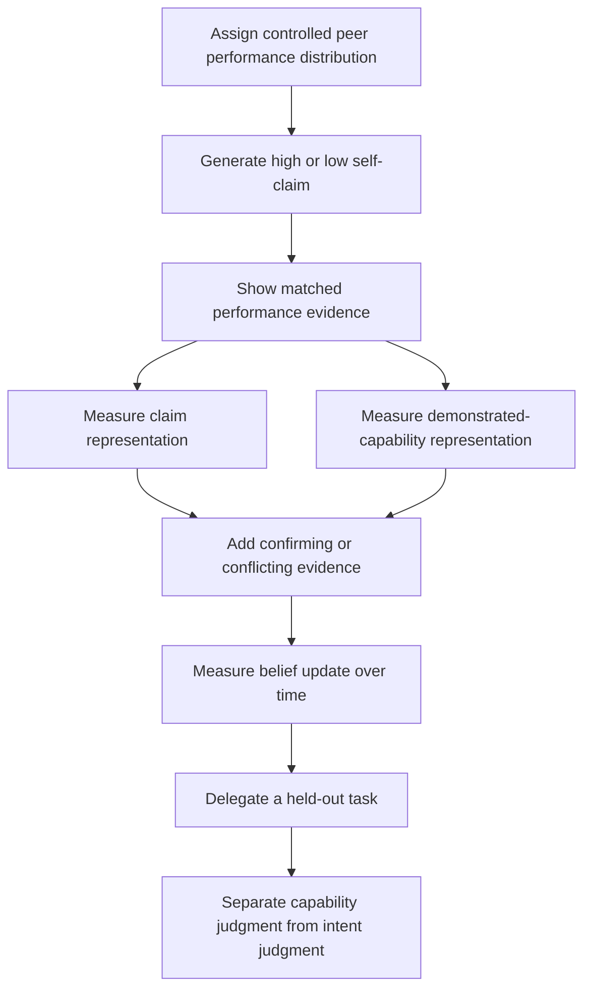
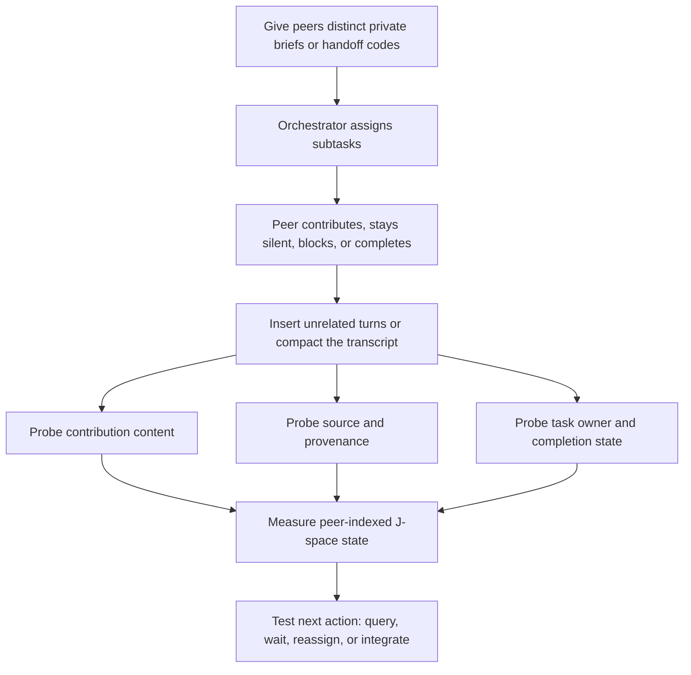
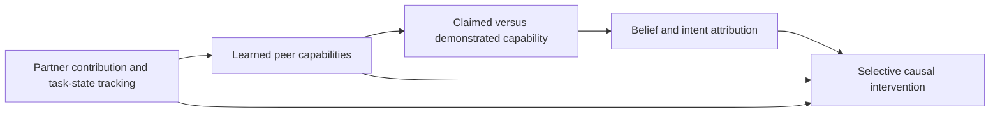

# Next experiments for learned peer models and collaborative theory of mind

## Purpose and status

This document records the research direction developed after reviewing the Qwen3-8B
and Qwen3-32B results. It is a planning document, not a preregistration and not a
reinterpretation of the original preregistered results. Before any confirmatory run,
the chosen protocol, primary outcomes, exclusions, independent statistical units,
and multiplicity correction should be frozen separately.

The long-term goal is to determine whether an LLM orchestrator maintains a functional
internal model of its collaborators: what each peer can do, what each peer knows or
believes, what each peer is currently working on, and how evidence should update those
assessments. J-space is one candidate measurement interface for these representations.

The central distinction throughout this plan is between:

- information being present in the prompt;
- information becoming available while the model prepares an answer;
- a peer-indexed representation persisting before the answer is requested;
- that representation updating after new evidence; and
- the representation causally controlling collaboration behavior.

Only the later items constitute strong evidence that the orchestrator maintains a
peer model rather than reconstructing an answer from the immediate prompt.

## What the completed results currently establish

### Experiment 0: the original belief gate failed

The preregistered Experiment 0 gate asked whether the peer-belief word outranked a
decoy at the final story token, before the question was asked, on both false-belief
items and matched true-belief controls.

- Qwen3-8B: belief beat the decoy on 52.5% of false-belief items and 47.5% of controls.
- Qwen3-32B: belief beat the decoy on 62.5% of false-belief items and 40% of controls.
- The control result is especially important: increasing the sample size would
  estimate the wrong-direction effect more precisely, not make the gate pass.
- The audit reproduced all saved measurements and did not find incorrect core labels
  or behavioral-scoring discrepancies. Prompt and output formatting were sensitive,
  but a later answer prefill cannot repair the earlier story-end representation.

Consequently, downstream J-space signals cannot presently be described as validated
representations of a peer's beliefs, intentions, or theory of mind. This does not show
that J-space contains no peer-related information. It limits the interpretation of
that information.

### Experiment 3: decision availability is strong; pre-decision capability is not

The contextual specialist task produced a visually striking result: at the decision
site, J-space preferred the appropriate peer in 97.9% of trials at both 8B and 32B,
and behavioral delegation was 91.7% and 100%, respectively.

However, the preregistered readout on the task text, before the model was asked to
choose, was 50% at 8B and 54.2% at 32B. The strong decision-site readout was also close
to output and logit preference. The defensible interpretation is therefore:

> The correct peer's identity becomes strongly available during answer preparation,
> but the current data do not establish a persistent capability representation before
> the delegation query.

The peer specializations were supplied explicitly as work histories. They were not
learned from observed peer performance.

### Experiment 1: collaboration framing did not produce a robust richer peer model

At 8B, the task-level team-minus-named-solo partner-keyword effect was 0.0069 with a
standard deviation of 0.0140. At 32B, the effect reversed to -0.0123. Team framing
made names and team language more visible, but partner-work representation, uptake,
and cross-agent similarity did not consistently improve.

This suggests that social framing alone is a weak manipulation. Future work should
manipulate actual information transfer, responsibility, and demonstrated competence.

### Experiment 2: false content is clearer than deceptive intent

False claims generally produced more suspicion-related signal than true claims, but
an impersonal document could produce an even stronger signal and the incentive effect
was weak. The current result is more consistent with factual-error detection than a
specific representation of a peer's deceptive intent.

### Bandit and ablation results

The bandit orchestrator did not reliably converge on the better peer; choice entropy
remained high and regret remained nonzero. The completed 8B causal ablation reduced
the legacy catch score relative to a matched edit, but also caused smaller changes in
fluency and copying. This supports causal relevance of the edited directions, not a
selective, validated peer-belief mechanism.

## Statistical planning assumptions

The original project uses 80% power at approximately alpha = 0.01 as a conservative
planning target. Under the same normal approximations, a binary effect against 50%
requires approximately:

| Expected success rate | Independent units needed |
|---:|---:|
| 55% | 1,166 |
| 60% | 290 |
| 65% | 127 |
| 70% | 71 |
| 75% | 44 |
| 80% | 30 |
| 90% | 15 |

For a paired continuous outcome, such as a within-task J-space margin:

| Standardized paired effect | Independent pairs needed |
|---:|---:|
| 0.3 | 130 |
| 0.4 | 73 |
| 0.5 | 47 |
| 0.6 | 33 |
| 0.8 | 19 |

These counts apply to independent units. Repeated turns from one conversation are not
independent replications. Analysis should cluster by task, peer profile, fact,
scenario, or session as appropriate. A small number of long conversations cannot be
treated as hundreds of independent observations.

## Proposed Experiment A: dynamically learned peer capabilities

### Research question

Can an orchestrator infer that a peer is capable in a task domain from observed
performance, retain the peer-capability association, and generalize it to a new task
without an explicit specialization profile?

### Proposed workflow

```mermaid
flowchart LR
    A[Create two unlabeled peers] --> B[Give peers diagnostic tasks]
    B --> C[Expose orchestrator to outputs and objective outcomes]
    C --> D[Insert delay and unrelated interaction]
    D --> E[Present novel transfer task]
    E --> F[Measure pre-query peer-capability state]
    F --> G[Ask orchestrator to delegate]
    G --> H[Measure decision-site state and behavior]
    H --> I[Swap roles, names, order, and evidence sequence]
```

### Recommended design

- Give peers objectively gradable tasks rather than subjective plan-writing tasks.
- Use a pronounced but imperfect specialization difference in the first study, such
  as 90% versus 30% success within a domain.
- Never state that a peer is a developer, researcher, or expert.
- Use demonstrations from multiple surface forms, followed by novel same-domain
  transfer tasks.
- Counterbalance peer names, roster order, response length, style, and the temporal
  order of successes and failures.
- Include equal-capability and reversed-capability controls.
- Remove or summarize earlier transcripts before some test trials to distinguish
  persistent state from direct lexical retrieval.

### Primary outcomes

1. A pre-decision J-space margin favoring the empirically stronger peer.
2. Delegation accuracy on held-out tasks.
3. Change in the peer-capability margin after new successes or failures.
4. Generalization to tasks not seen during capability demonstration.

Decision-site name rank should be secondary because the existing experiment shows it
can largely restate the imminent answer. J-space should also be compared with logit,
output, behavioral, and non-J-space representation baselines.

### Feasibility

The current bandit result is close to chance, so simply scaling the existing protocol
would be inefficient. A 54% routing rate could require well over 1,000 nominally
independent trials. With clearer evidence, a 70% effect would require about 71
independent profiles; a paired J-space effect of standardized size 0.5 would require
about 47 profiles. A reasonable plan is a 24-32-profile pilot followed by a frozen
64-96-profile study if the pilot suggests a moderate effect.

### Advantages

- Directly tests the project's central capability-modelling claim.
- Removes the explicit-profile confound from the current specialist experiment.
- Supports clean name, role, task, and evidence-sequence counterbalancing.
- Can measure acquisition, persistence, updating, transfer, and behavior separately.

### Risks and limitations

- Strong behavioral routing may occur without a continuously maintained peer model.
- Weak feedback can make the experiment a reinforcement-learning test rather than a
  representational test.
- A name preference at answer time may again be output preparation.
- Capability must be operationalized as a performance distribution, not treated as an
  inaccessible essential property of the peer.

### Positive interpretation

A compelling result would require the internal margin to follow the demonstrated
specialization through name and role swaps, persist across a delay, update after new
evidence, predict held-out delegation, and ideally respond selectively to a causal
intervention.

## Proposed Experiment B: prompted state versus demonstrated capability

### Research question

When a peer's self-description conflicts with its observed performance, does the
orchestrator represent and use the claim, the evidence, or both? Can it distinguish
incompetence, uncertainty, overconfidence, and deliberate misrepresentation?

### Factorial design

| Claimed capability | Demonstrated capability | Operational condition |
|---|---|---|
| High | High | Truthful strong peer |
| Low | Low | Truthful weak peer |
| High | Low | Overclaiming or imposter candidate |
| Low | High | Underclaiming strong peer |

The words "true capability" should mean an experimentally controlled performance
distribution. It should not imply access to an unknowable intrinsic trait.

### Proposed workflow

### Primary analysis

Use the interaction between claimed and demonstrated capability, paired by peer/task
profile. The central contrast should determine whether evidence changes the effect of
the claim. Separate structured outcomes should ask:

- How capable is the peer?
- How confident is the orchestrator in that estimate?
- What does the peer appear to believe about its own capability?
- Was the claim inaccurate?
- Was the inaccuracy intentional?

The last two must not be merged. Wrong, overconfident, and deceptive peers can produce
similar text but imply different mental-state judgments.

### Feasibility

For a paired interaction of standardized size 0.5, approximately 47 independent peer
profiles are needed; size 0.4 requires about 73. A balanced 60-80-profile study is a
reasonable initial target, with multiple observations per profile used for precision
rather than counted as independent samples.

### Advantages

- Separates peer self-report from behavioral evidence.
- Extends learned capability modelling toward epistemic source evaluation.
- Provides meaningful conflict trials rather than relying on suspicion words alone.
- Can reveal whether the orchestrator updates gradually or follows the latest claim.

### Risks and limitations

- Ignoring a consistently failing peer may be ordinary evidence aggregation, not ToM.
- Intent cannot be inferred from falsehood alone.
- Linguistic style, confidence, and verbosity may leak the experimental condition.
- This experiment is difficult to interpret unless Experiment A first demonstrates
  reliable learned capability tracking.

### Positive interpretation

A capability result is justified if delegation and the pre-decision representation
follow demonstrated evidence when it conflicts with a claim. A stronger ToM result
requires a separate, validated representation of what the peer believes or intends,
not merely whether its statement is accurate.

## Proposed Experiment C: renewed validation of peer-belief representations

### Research question

Can a revised and independently validated measurement distinguish a peer's belief
from world truth, stale story information, the orchestrator's own belief, and what was
most recently mentioned?

This is a replacement validation study, not a post-hoc amendment that makes the
original Experiment 0 pass.

### Proposed workflow

```mermaid
flowchart LR
    A[Generate paired belief and control scenarios] --> B[Assign distinct peer and world states]
    B --> C[Measure after observation]
    C --> D[Change world while peer is absent]
    D --> E[Measure before any question]
    E --> F[Probe peer belief, world truth, and self belief separately]
    F --> G[Apply paraphrase and format variants]
    G --> H[Validate on untouched held-out scenarios]
    H --> I[Perform selective causal intervention]
```

### Measurement improvements

- Treat the existing data as discovery data and use entirely new held-out items for
  confirmation.
- Freeze the revised protocol before opening the validation results.
- Measure at multiple causal moments: after observation, after the world changes,
  before the question, and during answer generation.
- Decode peer belief, actual state, orchestrator belief, and stale mentioned state as
  competing hypotheses.
- Use multi-token semantic or contrastive representations rather than relying only on
  isolated watched vocabulary tokens.
- Require invariance across paraphrases, entity names, answer formats, and role swaps.
- Compare J-space with linear probes, logit/output baselines, and other representation
  methods using the same independent units.
- Test whether an intervention can change the peer-belief readout without changing
  world-state decoding or general language quality.

### Feasibility

The existing protocol should not be scaled unchanged. At 8B its tiny effects imply
roughly 4,669 items per side, while the control is in the wrong direction. At 32B the
false-belief rate is more promising, but the control remains in the wrong direction.

For a genuinely revised gate, a 70% success rate against chance requires about 71
independent items per cell; 65% requires about 127. Because false-belief and matched
control cells must both pass and prompt forms should replicate, approximately 100-150
paired scenarios per model is a defensible target.

### Advantages

- Necessary for claims about belief, knowledge, intent, or theory of mind.
- Directly tests the construct validity missing from downstream experiments.
- Can reveal whether the original failure came from position, tokenization, prompt
  form, representation choice, or genuine absence of the hypothesized signal.

### Risks and limitations

- Repeatedly modifying the gate until it passes would create severe researcher-degree-
  of-freedom and overfitting problems.
- A successful decoder need not imply that the model uses the decoded state.
- A failed vocabulary projection does not prove that no distributed belief state
  exists elsewhere in the network.
- This experiment has the highest scientific value for ToM claims and the greatest
  probability of a clean negative result.

### Positive interpretation

The gate should require correct discrimination on both false-belief items and matched
controls, across unseen templates and prompt formats. A causal result should selectively
alter peer-belief-dependent behavior while leaving world-state knowledge intact.

## Proposed Experiment D: partner contribution and task-state tracking

### Research question

After assigning work to a peer, does the orchestrator maintain who owns the task,
what that peer contributed, what the peer knows, and whether the work is assigned,
in progress, blocked, completed, or reassigned?

### Proposed workflow

### Recommended state conditions

- assigned but no contribution received;
- contribution received but not verified;
- completed successfully;
- blocked or failed;
- reassigned from one peer to another;
- conflicting contributions from two peers;
- contribution available only through a peer message versus available in a neutral
  document control.

### Separate outcomes

The experiment should not collapse all success into a single retrieval score. Measure:

1. **Content:** What was contributed?
2. **Provenance:** Which peer contributed it?
3. **Responsibility:** Who currently owns the subtask?
4. **Epistemic access:** Which peer has seen or knows the information?
5. **Temporal state:** Is the work assigned, active, blocked, complete, or reassigned?
6. **Action selection:** Should the orchestrator query, wait, reassign, or integrate?

The audited follow-up v2 already proposes private briefs, exact handoff codes, frozen
peer messages, and no-peer probes. This experiment extends that foundation from exact
information transfer to persistent peer-indexed collaborative state.

### Feasibility

This is the most technically feasible proposal because it can use exact codes and
objective state labels. The original collaboration-framing effect was unstable, but
actual information transfer is a stronger manipulation than changing social wording.

For a moderate paired J-space effect, approximately 47 independent tasks are needed.
A 64-task main study would support template variation, held-out tests, and clustered
analysis. A smaller 16-24-task pilot can validate the state machine, probes, and trace
positions but should not be treated as confirmatory evidence.

### Advantages

- High probability of producing interpretable positive or negative results.
- Directly tests peer-indexed memory, provenance, responsibility, and workflow state.
- Creates objective labels and exact retrieval checks.
- Provides a bridge from simple communication memory to capability and belief models.
- Can test whether representations persist when the source message is no longer locally
  salient.

### Risks and limitations

- If the full transcript remains available, success may be direct copying.
- Remembering a code does not establish understanding of the peer.
- Recency, name frequency, and message length can masquerade as provenance tracking.
- Task ownership and knowledge attribution must be tested separately: being assigned a
  task does not imply that the peer completed it or knows its answer.

### Positive interpretation

A strong result would show separable representations of content, source, ownership,
knowledge access, and completion state; persistence after intervening conversation;
correct updates after reassignment; prediction of the next collaborative action; and
selective causal sensitivity.

## How the four experiments fit together

The progression intentionally moves from the most observable collaborative state to
the strongest mental-state claim:

1. Track what a peer contributed and what task it owns.
2. Infer what the peer is capable of from evidence.
3. Reconcile the peer's claims with demonstrated capability.
4. Distinguish what the peer believes or intends from what is actually true.
5. Intervene on each representation and test whether behavior changes selectively.

Experiment C should also run as a parallel construct-validation program. Experiments
A, B, and D can establish functional collaborator modelling even if classical
false-belief validation remains negative, but they should not be relabeled as ToM
without that validation.

## Recommended execution order

### Stage 1: measurement and infrastructure validation

- Finish the already designed audited follow-up and semantic rescoring.
- Standardize band-mean J-space, logit, output, and behavioral baselines.
- Record multiple causal positions rather than only answer-adjacent positions.
- Validate exact prompt rendering, token spans, entity swaps, and trace integrity.

### Stage 2: partner contribution and task state

- Run Experiment D first because it has objective labels and high feasibility.
- Establish whether peer-indexed content and provenance can persist beyond local
  message copying.

### Stage 3: learned capability

- Pilot Experiment A with strong performance differences.
- Freeze a powered confirmatory design only after estimating the independent-unit
  effect and checking for name, order, style, and recency leakage.

### Stage 4: conflicting claims and evidence

- Run Experiment B only after capability learning is reliable.
- Keep capability, inaccurate claim, self-belief, and deceptive intent as separate
  outcomes.

### Stage 5: belief validation and causal tests

- Run the revised Experiment C on untouched held-out scenarios.
- Apply matched interventions only to representations that passed behavioral,
  baseline, and generalization gates.

## Shared safeguards for all experiments

- Preregister one primary outcome per central claim.
- Freeze analysis before confirmatory results are opened.
- Use independent tasks, facts, profiles, or sessions as statistical units.
- Report effect sizes and uncertainty, not only p-values.
- Correct for the frozen primary family; do not drop failed tests from multiplicity.
- Counterbalance names, order, roles, wording, and evidence sequence.
- Include equal-state, reversed-state, and neutral-document controls.
- Compare J-space with logit, output, behavioral, and alternative representation
  baselines at equivalent positions and layer-pooling opportunities.
- Treat answer-adjacent readouts as evidence of decision availability, not persistent
  representation, unless earlier measurements agree.
- Separate discovery datasets from untouched confirmatory datasets.
- Preserve complete prompts, outputs, traces, model revisions, configuration hashes,
  scorer versions, and explicit failures.
- Do not treat a decodable state as causally used until an appropriately matched
  intervention changes behavior selectively.

## Claims this program could support

Evidence should be accumulated in increasing order of strength:

1. The model can retrieve peer-related information.
2. The model binds information and task state to a peer identity.
3. The binding persists and updates across interaction.
4. The binding predicts delegation and communication behavior.
5. The binding causally controls that behavior.
6. The representation distinguishes a peer's knowledge or belief from world truth.
7. The representation distinguishes capability error from deceptive intent.

The current results provide partial evidence near levels 1-2 at decision time. The
next experiments should be designed to advance one level at a time rather than using
one successful name-ranking metric to claim the entire hierarchy.

## Bottom line

The current project has not validated J-space as a direct window into theory of mind.
It has shown enough peer-related and causally relevant signal to justify a focused
next program. The best immediate target is persistent peer-indexed contribution and
task-state tracking, followed by capability learning from observed performance. A
prompted-versus-demonstrated capability experiment is valuable once that foundation
works. A newly frozen, held-out belief validation study remains mandatory for the
strongest ToM interpretation.
